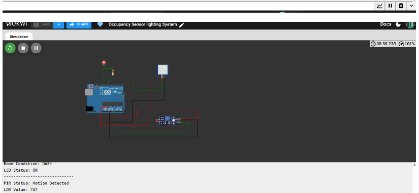
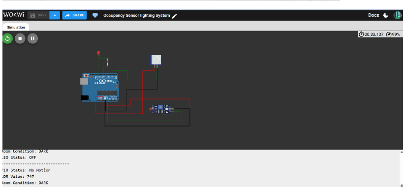

# Occupancy-Based Smart Lighting System

An Arduino UNO-based IoT mini-project that switches a room light on only when **motion is detected and the room is dark**. The circuit and logic were demonstrated using the Wokwi online simulator.

> **Project scope:** this repository describes a local embedded-control simulation. It does not include Wi-Fi/cloud connectivity or a physical hardware deployment.

## Demo

- **Wokwi simulation:** https://wokwi.com/projects/478197243872036865
- **Main sketch:** [`sketch.ino`](sketch.ino)
- **Circuit diagram:** [`docs/circuit-diagram.png`](docs/circuit-diagram.png)

### Simulation screenshots

**Dark room + motion detected — LED ON**



**Dark room + no motion — LED OFF**



## Features

- Reads motion from a PIR sensor.
- Reads ambient light level from an LDR module.
- Applies AND logic: both motion and darkness must be detected before switching the LED on.
- Prints motion status, LDR reading, room condition and LED state to the Serial Monitor at 9600 baud.
- Checks the sensors once per second.

## Components

| Component | Purpose |
|---|---|
| Arduino UNO | Reads sensors and controls the output |
| PIR motion sensor | Reports motion on a digital output |
| Photoresistor (LDR) module | Measures ambient light through its analog output |
| LED | Represents the room light |
| Current-limiting resistor (220 Ω in the simulated circuit) | Limits LED current |
| Jumper wires | Connect power, ground and signals |

## Pin connections

| Arduino pin | Connects to | Mode / purpose |
|---|---|---|
| D2 | PIR OUT | Digital input for motion status |
| A0 | LDR AO | Analog input for light level |
| D9 | LED through resistor | Digital output for lighting |
| 5V | PIR VCC and LDR VCC | Sensor power |
| GND | Sensor grounds and LED return | Common ground |

See the Wokwi project for the interactive wiring and component layout.

## Control logic

The sketch uses `DARK_THRESHOLD = 600` and considers the room dark when `analogRead(A0) > 600` in the provided Wokwi setup.

| Motion | LDR reading | Interpreted room | LED |
|---|---:|---|---|
| Detected | 453 | Bright | OFF |
| Not detected | 453 | Bright | OFF |
| Detected | 747 | Dark | ON |
| Not detected | 747 | Dark | OFF |

The numeric LDR readings are examples from the recorded simulation, not universal sensor calibration values.

## Run the project

### In Wokwi

1. Open the [Occupancy-Based Smart Lighting Wokwi project](https://wokwi.com/projects/478197243872036865).
2. Start the simulation.
3. Open the Serial Monitor and observe the PIR state, LDR value, room condition and LED status.
4. Change the motion sensor state and photoresistor illumination to test the four combinations in the table above.

### With Arduino IDE and hardware

1. Open `sketch.ino` in the Arduino IDE.
2. Select **Arduino Uno** and the correct serial port.
3. Connect the modules according to the pin table.
4. Upload the sketch and open the Serial Monitor at **9600 baud**.
5. Adjust `DARK_THRESHOLD` if needed after testing the actual LDR module. The direction and scale of readings can vary with hardware and wiring.

## Algorithm

1. Initialize the PIR input, LED output and Serial Monitor.
2. Read the PIR digital state and LDR analog value.
3. Set `occupied` when PIR is HIGH.
4. Set `isDark` when the LDR reading exceeds the threshold.
5. Turn the LED on only when `occupied && isDark`; otherwise turn it off.
6. Print the current readings and repeat after one second.

## Limitations and future work

- A PIR detects motion, not continuous human presence; the current sketch has no occupancy timeout.
- The light threshold is fixed rather than calibrated automatically.
- The demonstrated version is local control only; it has no wireless connectivity, cloud dashboard or remote monitoring.
- Possible extensions include an adjustable/calibrated threshold, an off-delay after the last motion event, and ESP32-based Wi-Fi monitoring.

## Repository contents

```text
occupancy-based-smart-lighting/
├── README.md
├── sketch.ino
├── .gitignore
├── assets/
│   ├── dark-motion-led-on.png
│   └── dark-no-motion-led-off.png
└── docs/
    └── circuit-diagram.png
```

## Author

Aditya Shenoy B — Fundamentals of Internet of Things mini-project.
